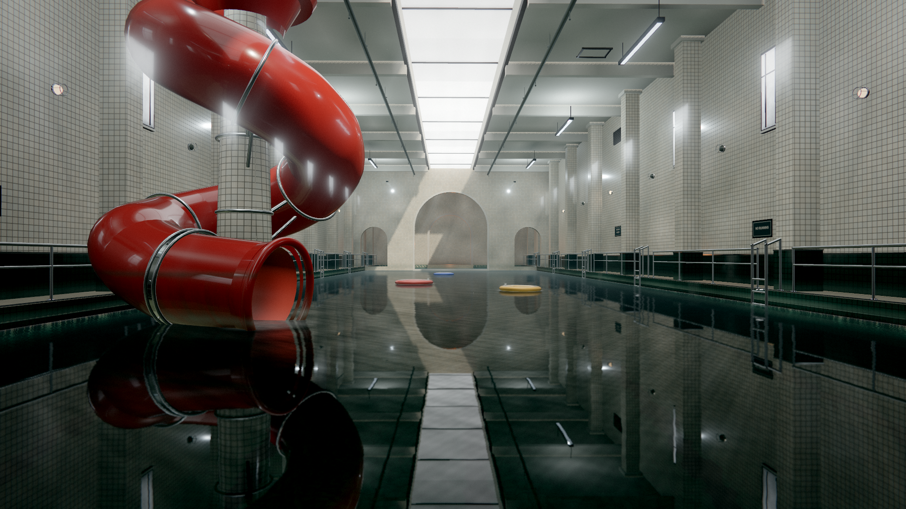

[](https://github.com/deepseek-ai/deepseek-harness)

made with `deepseek-v4.1-flash-1017` and [dsh-swarm](https://github.com/4t145/dsh-swarm)

# THE POOL

One flooded municipal pool hall, rendered in real time. White glazed tile, a long
overcast skylight, black-green water, a red corkscrew flume that should not be
here. Nothing moves except the water, three inflatable rings and a tired
fluorescent tube.

The project is a single-scene, code-authored demo built for **trailer-grade
stills and motion**: it has to survive a 3840×2160 screenshot and a slow camera
move, not just a quick gameplay check. Every texture, mesh, light bake and camera
path is generated at runtime — there are no downloaded assets, no runtime network
requests, and no second room.



`pnpm stills` renders the seven committed 1920×1080 frames plus a 3840×2160 hero
still into `stills/`; `pnpm trailer` cuts them into a 2.39:1 H.264 trailer. See
[Implementation](docs/IMPLEMENTATION.md) for the pipeline, bake, tiers and
measured performance, and [Art Direction](docs/ART_DIRECTION.md) /
[Acceptance](docs/ACCEPTANCE.md) for the look and the bar.

## Run

Requires Node 24+, pnpm, and a local Chrome for capture (see
[Browser capture](#browser-capture)).

```sh
pnpm install --frozen-lockfile
pnpm dev          # http://127.0.0.1:5173
```

The first load generates the tile set, builds the room and bakes the light probes;
the loader reports each stage and the app sets `window.__POOL_READY__` when the
first frames have resolved.

### Controls

| Input | Action |
| --- | --- |
| `1`–`7` | select a camera shot (arrival, flume, ring, arch, skylight, tile, float) |
| `←` / `→` | previous / next shot |
| `Space` | resume the guided cinematic |
| `F` | free look (WASD, Q/E for up/down, Shift to move faster; click to lock the mouse) |
| `H` | hide/show the HUD |
| `L` | toggle the 2.39:1 letterbox |
| `Esc` | leave free look |
| click the image | return to the guided take |

### URL parameters

| Parameter | Values | Effect |
| --- | --- | --- |
| `quality` | `low`, `medium`, `high`, `ultra` (default) | quality preset (see [Implementation](docs/IMPLEMENTATION.md)) |
| `shot` | shot id | start locked on one shot, e.g. `?shot=arrival` |
| `t` | seconds | fix the scene clock (pauses the update loop) |
| `capture` | `1` | capture mode: no HUD, no intro fade, deterministic |
| `hud` | `0`/`1` | force HUD off/on |
| `letterbox` | `0`/`1` | force the 2.39:1 mask |
| `free` | `1` | start in free look |
| `seed` | integer | texture/procedural seed (default `20261029`) |
| `scale` | number | override the render-resolution multiplier |

## Capture and deliverables

The capture bench runs the real app in headed Chrome on hardware WebGL
(`DISPLAY=:0`), waits for `__POOL_READY__`, then drives the stable
`window.__pool` API. Every image is rendered at an explicit scene time through
`renderAt(t)`, so captures are reproducible.

```sh
pnpm stills        # seven 1920x1080 stills + 3840x2160 hero -> stills/ (+ manifest.json)
pnpm trailer       # 1920x1080 24 fps 2.39:1 H.264 -> stills/trailer.mp4 (+ trailer.json)
pnpm shot -- --shot=arrival --width=1920 --height=1080 --time=2.4   # one ad-hoc still -> shots/
pnpm determinism   # two fresh runs must be pixel-identical (fails otherwise)
pnpm perf          # fps p50/p95/max, draw calls, triangles, low-preset boot
```

`stills/manifest.json` records the exact scene time, size, renderer stats and
SHA-256 of every committed frame; `stills/trailer.json` records the frame plan,
cross-dissolve chain and the `ffprobe` verification of the encoded file. Ad-hoc
captures land in `shots/` (gitignored); committed deliverables land in `stills/`.

Useful options: `pnpm stills -- --quality=high --shots=arrival,flume`,
`pnpm trailer -- --seconds=24`, `pnpm shot -- --all --time=2.4`.
Capture flags are documented at the top of each script in `scripts/`.

## Verification

```sh
pnpm typecheck
pnpm test
pnpm build
```

`pnpm test` covers the non-trivial math: deterministic RNG, camera path/loop and
framing, water optics (Snell, Beer–Lambert, wakes, caustics), tile profile and
POM stepping, post/display-transform math, prop layout, room-detail placement and
the trailer plan.

## How it is built

```
src/
  app/            boot, settings, quality tiers, cinematics, closed camera path
  core/           deterministic RNG, math, water optics, tile math, post math,
                  bake math, shader hook chain
  render/         HDR scene target, emissive-mask bloom pyramid, single display
                  transform (AgX/ACES), grade, grain, CA, letterbox
  world/
    layout.ts     single source of truth: dimensions, anchors, shots, take keys
    textures.ts   procedural tile / grime / water / sign / vinyl texture sets
    materials.ts  shared PBR library wired through the tile shader
    tileMaterial.ts  glazed ceramic shader: POM, per-tile variation, grime
    architecture.ts  shell, skylight, windows, columns, arch screen, corridor, stairs
    architectureDetail.ts  coping grates, lane markings, lamps, services, notices
    props.ts      corkscrew flume, rings, ladders and rails (merged batches)
    lighting.ts   sun, area lights, IBL bake, probe-grid bake, volumetrics
    water.ts      reflection/refraction targets, water shader, wakes, caustics
scripts/          deterministic capture bench (stills, trailer, perf, determinism)
docs/             art direction, technical contract, acceptance, implementation
```

The scene renders linear HDR with `NoToneMapping` into a half-float MSAA target;
the final post pass owns the only display transform. The camera is only moved by
`Cinematics`, all animation is driven by the scene clock, and `LAYOUT` is the
coordinate contract shared by water, tile, props, lighting and cameras.

## Browser capture

`scripts/chrome-env.sh` bootstraps the local Playwright Chrome build against the
NixOS shared libraries and uses `DISPLAY=:0` for hardware WebGL. Override
`CHROME_BIN` if Chrome lives elsewhere. Headless Chrome falls back to
SwiftShader on this machine, so the bench runs a headed, off-screen window,
brings it to the front (an unfocused window throttles `requestAnimationFrame`),
and reads frames from the WebGL drawing buffer.

## Constraints

- Everything is procedural/code-authored. No downloaded textures, HDRIs or
  models; no network dependency at runtime.
- One continuous scene. No portals, no second level, no gameplay, no story UI.
- Determinism matters: animation uses the scene clock, never wall clock;
  `renderAt(t)` is pixel-stable apart from the deterministic 24 fps grain.
- The `window.__pool` API and `LAYOUT` semantics are stable so captures and
  independent systems stay aligned. The API is `renderAt`, `setShot`,
  `setCinematic`, `setPaused`, `setLetterbox`, `setHud`, `setExposure`,
  `setBloom`, `getStats`, plus `camera`, `scene`, `renderer` and `time()`.
