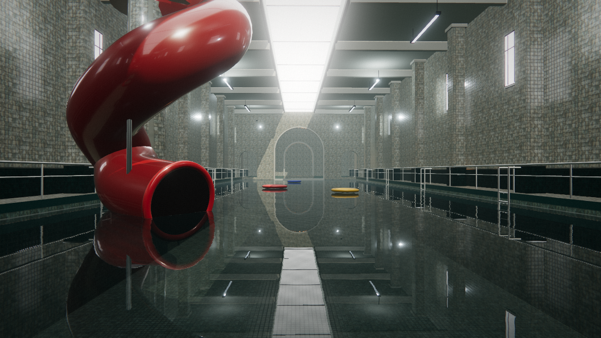

# THE POOL

A single-scene, real-time liminal pool. One flooded municipal hall, glazed white
tile, overcast skylight, black-green water, a red flume that should not be here.

The project targets **trailer-grade stills and motion**: it must survive a 4K
screenshot and a slow camera move, not just a quick gameplay check.

## Status

Baseline scaffold (lead): renderer, HDR post chain, procedural tile set, room
shell, water planar reflection, hero flume, rings, camera shots, deterministic
screenshot pipeline.

The look is intentionally unfinished. The Swarm run is responsible for the
material, lighting, water, prop and cinematography finish described in
[Art Direction](docs/ART_DIRECTION.md) and [Acceptance](docs/ACCEPTANCE.md).



## Run

Requires Node 24+, pnpm, and local Chrome for testing (see
[Browser capture](#browser-capture)).

```sh
pnpm install
pnpm dev          # http://127.0.0.1:5173
```

Controls:

| Key | Action |
| --- | --- |
| `1`–`7` | select camera shot |
| `←` / `→` | previous / next shot |
| `Space` | resume the guided cinematic |
| `F` | free look (WASD, Q/E, Shift to move faster, click to lock mouse) |
| `H` | hide/show HUD |
| `L` | letterbox |

## Capture

```sh
# one 1920x1080 still, deterministic scene time
pnpm shot -- --shot=arrival --width=1920 --height=1080 --time=2.4

# all seven shots
pnpm shot -- --all --width=1920 --height=1080 --time=2.4

# 4K hero frame
pnpm shot -- --shot=flume --width=3840 --height=2160 --time=2.4
```

Stills land in `shots/` (ignored). The capture script runs Chrome with hardware
WebGL on `DISPLAY=:0`, off-screen, and waits for `window.__POOL_READY__`.

## Verification

```sh
pnpm typecheck
pnpm test
pnpm build
```

## Layout

```
src/
  app/            App boot, settings, quality presets, cinematics
  core/           deterministic RNG and math
  render/         HDR scene target, bloom pyramid, ACES + grade composite
  world/
    layout.ts     single source of truth for dimensions, anchors, shots, path
    textures.ts   procedural tile / water / sign / noise textures
    materials.ts  shared PBR material library
    architecture.ts  shell, skylight, windows, columns, arch screen, stairs
    props.ts      flume, inflatables, ladders, railings
    lighting.ts   sun, area lights, IBL bake, fog
    water.ts      planar reflection, normal distortion, foam, absorption tint
scripts/
  chrome-env.sh   local NixOS Chrome shared-library bootstrap
  shot.mjs        deterministic still capture
docs/             art direction, technical contract, acceptance criteria
```

## Browser capture

`scripts/chrome-env.sh` bootstraps the Playwright Chrome build against NixOS
shared libraries and uses `DISPLAY=:0`. Override `CHROME_BIN` if Chrome lives
elsewhere. Headless Chrome falls back to SwiftShader on this machine; the
screenshot script therefore runs a headed, off-screen browser window and captures
through CDP.

## Constraints

- Everything is procedural/code-authored. No downloaded textures, HDRIs or
  models; no network dependency at runtime.
- The scene is one continuous space. No portals, no second level.
- Determinism matters: animation uses the scene clock, never wall clock.
- Keep the `window.__pool` API and `LAYOUT` semantics stable so captures and
  independent systems stay aligned.
